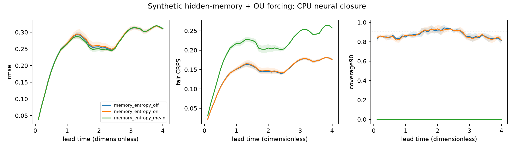

# 직접 entropy 입력 비교 결과

2026-11-16 · 로컬 CPU · 실제 ERA5 학습/클라우드 실행 결과가 아님

## 구현한 입력

조건부 미해결 증분의 Gaussian 분포에서 `e = ∫p log p − ∫pref log pref = −log(σ/σref)`를 계산해 기억에 학습 가능한 보정으로 넣었다. 계산 순서는 `현재 상태 기억 → σ → e → 기억 보정 → 경향 적분 → 선택적 샘플링`이다. 현재 σ는 같은 시각의 보정된 기억을 다시 읽지 않는다.

이제 이 항은 단순한 진단값이 아니라 **네트워크가 읽는 기억 상태의 입력**이다. 다만 선택적 adapter/합성 모델에 구현했으며 기존 main의 ERA5 학습기를 변경·재학습한 것은 아니다.

## 대조와 결과

모두 같은 1,586개 매개변수, 초기 가중치·자료·학습 배치, 300 update, 학습 seed0/1/2, 폭16을 사용했다. 독립 train/validation/test 궤적과 train 기준 분산을 유지했다. 결과는 선행40개 평균의 학습seed 평균 ± 표준편차다.

| 비교군 | 평균 RMSE ↓ | 평균 fair CRPS ↓ | 90% coverage |
|---|---:|---:|---:|
| e=0 입력, 샘플링 on | 0.25841 ± 0.00398 | 0.14597 ± 0.00229 | 87.28% |
| 계산한 e 입력, 샘플링 on | 0.25932 ± 0.00697 | 0.14659 ± 0.00415 | 87.25% |
| 같은 on 학습법, 예보 샘플링 off | 0.25654 ± 0.00309 | 0.20770 ± 0.00327 | — (점 경로) |

이 조건에서는 직접 entropy 입력의 CRPS가 평균 0.43% 나빴고, seed별 변화 방향도 섞여 있었다. **entropy 입력이 필요하거나 유리하다는 증거를 얻지 못했다.** 작은 차이를 유의한 열화라고 주장하는 것도 아니다.

샘플링을 끈 경로는 비선형 모델의 앙상블 평균과 다르다. 분포 spread가 거의 0이므로 확률 예측 점수가 나빠지는 결과를 entropy 입력의 실패와 혼동하지 않는다.



## 입력이 실제로 작동하는가

- on의 학습된 entropy-to-memory 가중치는 0이 아니고, 입력도 0이 아니다.
- 학습한 on 가중치를 유지하고 e만 0으로 끄는 개입을 원자료에 기록했다. 예보가 크게 달라져 입력 의존성은 확인됐다.
- 이 개입은 학습 중 보지 못한 기억 상태를 만들 수 있다. 악화 자체를 entropy의 성능 이득이나 물리적 의미의 증거로 쓰지 않는다.
- 관측된 e는 평균 약0.43으로 상수 성분이 크다. 이후 상수 입력 대조를 추가해야 log-scale 변화의 정보와 추가 기억 bias의 효과를 구분할 수 있다.

Gaussian에서는 entropy 입력이 logσ의 다른 표현이다. 원시 entropy 최대화, 열역학적 entropy, 노이즈와의 일반적인 물리적 쌍대성, entropy 함수미분으로 유도한 동역학을 구현했다고 부르지 않는다.

## 검증과 재현

- 코드 commit: `03144a694b306b286f90235fe5126c4e0bde8ad7`. clean Git 상태와 코드 SHA256 3개가 일치한다.
- 3개 모델 ×3 seeds =9회, CPU2 threads, 52.1초. 모든 결과 유한·발산0.
- 집중 단위 테스트:40 passed,1 skipped. 실제 전체 core 연결 테스트는 의존성이 없어 skip이다.
- 앞선 기억/노이즈 비교72회와 합하면 총81회 학습이지만, 직접 entropy 입력의 대조는 이9회뿐이다.
- 클라우드 새 작업 생성은 서비스 응답이 없어 생성/실행을 확인하지 못했다.

```bash
EXECUTION_LABEL='실제 실행 위치' PYTHON_BIN=.venv-cpu/bin/python \
  OUTDIR=runs/memory_entropy_direct_cpu bash scripts/run_memory_entropy_cloud_cpu.sh entropy
```

원자료: [JSON](direct_entropy/results.json), [요약CSV](direct_entropy/summary.csv), [선행별CSV](direct_entropy/leads.csv).
