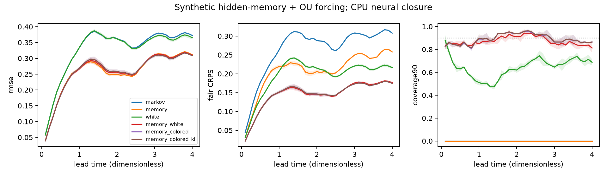

# 물리 기억·노이즈·엔트로피 CPU 예비 실험

2026-11-16 · **로컬 CPU 실행 결과** · 클라우드 실행 결과가 아님

## 결과가 말하는 것

이 작은 합성계에서는 기억이 평균 예측을 개선했고, 기억에 확률성을 더하면 주로 분포 예측이 개선됐다. 유색 노이즈나 KL이 백색 노이즈보다 확실히 낫다는 결과는 얻지 못했다. 실제 ERA5 장기 예보의 개선은 아직 검증하지 않았다.

## 현재 저장소와 제안의 관계

기준 main에는 이미 G(x) 특징, ConvGRU 기억과 누적 커널이 있다. 제안의 신규 부분은 기억 자체보다 **기억과 확률적 closure의 통합 및 분포 제약**이다. 다른 개발 브랜치의 노이즈 구현은 기억 옵션과 결합이 제한되어 있어 그대로 병합하지 않았다.

권장 구조는 `dX/dt = fθ(X,G(X),m) + η`, 기억은 과거 상태를 적분하는 보조 상태, η는 별도 확률적 강제력이다. `H[p] = -∫p log p`이므로 `∫p log p`는 음의 엔트로피다. 이는 경향 벡터와 단위가 다른 분포 함수이며, 입력에 더하는 것만으로 샘플별 노이즈가 생기지는 않는다. 이번에는 조건부 Gaussian NLL로 노이즈 크기를 학습하고 엔트로피를 진단했다. 별도 KL은 같은 평균의 기준 분산에 대한 제한된 정규화다.

## 실험 조건

- 생성계: 알려진 복원력 G(x)=-0.8x-0.1x³, 숨은 지수 커널 기억, OU 유색 힘.
- 학습기에는 관측 x와 G(x), 관측 과거만 제공. 숨은 기억·힘과 미래 정답은 자유 예보 입력에서 제외.
- train 128 / validation 32 / test 64개의 독립 궤적, 각각 96 step. 자료 seed 1729/1730/1731.
- 모델별 300 optimizer update, 폭16, 학습 seed0/1/2, 앙상블64, 과거16 step, 미래40 step. dt=0.1이며 날씨의 일 단위가 아니다.
- CPU2 threads. 본 실험18회 + 대조 실험54회 = **총72회 학습**. 합산 학습·평가 실행 시간 약 75.0초(환경 설치 제외).
- 표는 선행별 RMSE와 fair CRPS를 40개 선행에서 평균한 뒤 학습 seed 간 평균 ± 표준편차. 신뢰구간이 아니다.

## 본 실험

| 모델 | 매개변수 | 평균 RMSE ↓ | 평균 fair CRPS ↓ | 90% 구간 coverage |
|---|---:|---:|---:|---:|
| 현재 상태 + G, 결정론 | 337 | 0.3286 ± 0.0005 | 0.2653 ± 0.0003 | — (점 예보) |
| + GRU 기억, 결정론 | 1553 | 0.2571 ± 0.0021 | 0.2081 ± 0.0023 | — (점 예보) |
| 기억 없이 백색 노이즈 | 354 | 0.3261 ± 0.0030 | 0.1956 ± 0.0018 | 64.5% ± 0.8% |
| 기억 + 백색 노이즈 | 1570 | 0.2584 ± 0.0040 | 0.1460 ± 0.0023 | 87.3% ± 1.7% |
| 기억 + 유색 노이즈 | 1571 | 0.2589 ± 0.0044 | 0.1460 ± 0.0027 | 89.1% ± 0.5% |
| 기억 + 유색 노이즈 + KL | 1571 | 0.2589 ± 0.0044 | 0.1460 ± 0.0027 | 89.2% ± 0.5% |

기억 기준에 백색 노이즈를 더하면 CRPS는 약 **29.9% 낮아졌지만**, 평균 RMSE는 0.2571 → 0.2584로 좋아지지 않았다. 노이즈가 결정론적 평균 궤적 오차를 해결했다는 해석은 맞지 않는다.

백색·유색 모델의 CRPS는 둘 다 약 0.1460이다. 유색 모델 coverage는 89.1%로 90%에 가깝지만, 전체 예측/정답 분산 비율은 백색 1.00, 유색 1.15로 유색 쪽의 분산이 더 크다. 모든 측면에서 유색이 우세하다고 말할 수 없다.



그림의 음영은 학습 seed 표준편차다. 결정론 모델에는 확률 구간이 없어 coverage를 성능 비교로 직접 해석하지 않는다.

## 생성기 대조

| 대조 생성기 | Markov RMSE | 기억 RMSE | 기억+백색 CRPS | 기억+유색 CRPS |
|---|---:|---:|---:|---:|
| 물리 기억만 제거, OU 힘 유지 | 0.3662 | 0.2998 | 0.1735 | 0.1672 |
| 힘의 노이즈 제거, 기억 유지 | 0.0213 | 0.0065 | 0.0057 | 0.0057 |
| 물리 기억 제거 + 독립 백색 힘 | 0.1365 | 0.1374 | 0.0774 | 0.0774 |

물리 기억을 제거해도 OU 힘이 시간 상관을 유지하면 관측 x에는 기억이 남는다. 두 기억을 모두 없앤 Markov 대조에서는 GRU가 평균 RMSE를 개선하지 않았다. 노이즈가 없는 대조에서 노이즈를 추가한다고 평균 오차가 자동으로 줄지도 않았다. 각 생성기의 점수 절대값은 자료 분산이 달라 서로 직접 비교하지 않는다.

## 해석의 한계와 다음 단계

1. 합성 스칼라 신경망 연구이며 기존 66채널 ERA5 core를 재학습한 결과가 아니다.
2. GRU를 넣으면 매개변수도 늘어난다. 기억의 이득을 용량의 이득과 완전히 분리하려면 용량을 맞춘 추가 대조가 필요하다.
3. 학습 seed3개는 같은 독립 자료 split을 공유한다. 새로운 자료 seed까지 바꾸는 검증과 신뢰구간은 후속이다.
4. 학습된 AR rho는 GRU가 설명하고 남은 잔차 상관이다. 생성기의 물리적 OU 시간 상수를 복원했다는 뜻이 아니다.
5. 원시 엔트로피 최대화 실험은 하지 않았다. KL 추가가 본 실험에서 개선된다는 증거도 없다.
6. 실제 core adapter는 선택적 백색 노이즈 경로다. 유색 모델은 합성 연구 코드에서만 비교했다. 전체 core 연결 검증은 필요한 프로젝트 의존성이 없어 선택적 테스트1개가 skip되었다.
7. adapter의 최종 PositiveMass는 노이즈가 든 입력의 수분 총량을 보존한다. 결정론 예보의 전구 수분 총량을 보존하는 노이즈는 아직 아니다. 사영 후 Gaussian NLL로 최종 분포를 채점하면 안 된다.

다음 실제 기상 실험은 기존 기억 core에 확률 head를 연결해 5.625도 자료의 짧은 smoke를 수행하고, 동일 연도 분할·학습 예산·IC·seed로 결정론/백색/유색/분포 제약을 비교하는 것이다. RMSE 외에 CRPS, coverage, spread, 잔차·궤적 시간 상관과 질량·수분 drift를 함께 평가해야 한다.

## 재현과 원자료

코드 commit: `dfc14ffaa63df6751b98eb114bb18c36d601af31`. 모든 원자료 JSON은 clean Git 상태에서 이 commit으로 실행했으며 코드 SHA256·버전·호스트·seed·실행 label을 포함한다.

```bash
python3 -m venv .venv-cpu
.venv-cpu/bin/python -m pip install -r requirements-memory-entropy-cpu.txt
EXECUTION_LABEL='실제 실행 위치' PYTHON_BIN=.venv-cpu/bin/python \
  bash scripts/run_memory_entropy_cloud_cpu.sh study
EXECUTION_LABEL='실제 실행 위치' PYTHON_BIN=.venv-cpu/bin/python \
  bash scripts/run_memory_entropy_cloud_cpu.sh controls
```

원자료 폴더: [본 실험](main/results.json), [물리 기억 제거](no_physical_memory/results.json), [노이즈 제거](no_noise/results.json), [Markov 대조](markov/results.json). 각 폴더에 CSV와 선행별 그림도 포함한다.

검증: 새 코드 및 계약 테스트 **26 passed, 1 skipped**. 전체 ERA5 테스트 스위트·ERA5 학습·클라우드 실행을 완료했다고 주장하지 않는다.

이론 근거: [Lei et al., 2016: GLE 기억과 노이즈](https://pmc.ncbi.nlm.nih.gov/articles/PMC5167214/), [Jordan et al., 1998: 자유에너지와 Fokker–Planck](https://epubs.siam.org/doi/10.1137/S0036141096303359), [Gneiting & Raftery, 2007: proper scoring rules](https://sites.stat.washington.edu/raftery/Research/PDF/Gneiting2007jasa.pdf).
